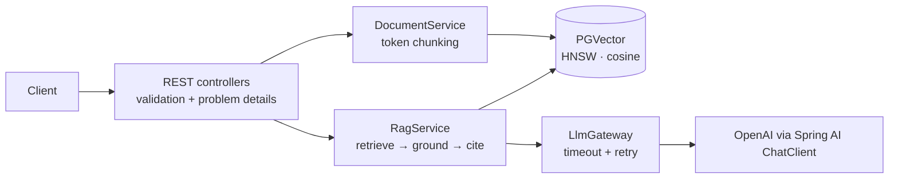

# Spring AI RAG Service

[](https://github.com/maaz-azhar-9/spring-ai-rag-service/actions/workflows/ci.yml)


A **production-style Retrieval-Augmented Generation (RAG) service** built with **Spring Boot, Spring AI and PGVector**. Index your documents and ask questions in natural language to get **cited, grounded answers** from your own content.

It's a small, readable codebase covering a model gateway behind an interface, input validation, hard timeouts with retries, and tests that don't need an API key.

## Features

| Endpoint | What it does |
|---|---|
| `POST /api/documents` | Index a document (JSON `title` + `content`) |
| `POST /api/documents/upload` | Index a `.txt` or `.md` file |
| `POST /api/ask` | Answer a question from the indexed documents, with `[n]` citations and sources |
| `GET /actuator/health` | Health check |

## Architecture



## Design decisions

- **Model access sits behind one interface (`LlmGateway`).** Business logic never touches `ChatClient` directly, so it's unit-tested with a mock and the provider can change in one place.
- **Hard timeouts with cancellation.** Every model call runs on a virtual thread with a bounded `get(timeout)`, and is cancelled and retried on timeout. An HTTP timeout alone doesn't stop a slow model from hanging a request thread.
- **No retrieval, no model call.** If nothing passes the similarity threshold, the service answers "not found" without calling the LLM. That's cheaper, faster and avoids hallucination.
- **Grounded answers with citations.** Context passages are numbered, and the prompt requires `[n]` citations. If the model says it can't answer, sources are hidden and `grounded` is `false`.
- **RFC 9457 problem details** for errors: 400 for validation, 503 when the model is unavailable.

## Quick start

```bash
cp .env.example .env            # add your OPENAI_API_KEY
docker compose --env-file .env up --build
```

Or run against a local Postgres with pgvector:

```bash
docker compose up -d db
OPENAI_API_KEY=sk-... mvn spring-boot:run
```

### Try it

```bash
# 1. Index a document
curl -X POST localhost:8080/api/documents -H 'Content-Type: application/json' \
  -d '{"title":"java-records.md","content":"Records are immutable data carriers introduced in Java 16. The compiler generates the constructor, accessors, equals, hashCode and toString."}'

# 2. Ask a grounded question
curl -X POST localhost:8080/api/ask -H 'Content-Type: application/json' \
  -d '{"question":"What does the compiler generate for a record?"}'
# → { "answer": "... constructor, accessors, equals, hashCode and toString [1].",
#     "sources": [{ "citation": 1, "title": "java-records.md", "score": 0.83 }], "grounded": true }

```

## Configuration

| Property | Default | Purpose |
|---|---|---|
| `rag.default-top-k` | `4` | Chunks retrieved per question |
| `rag.similarity-threshold` | `0.35` | Minimum similarity for a chunk to count |
| `rag.chunk-size` | `400` | Target chunk size in tokens |
| `rag.llm-timeout` | `30s` | Hard limit per model call |
| `rag.llm-max-attempts` | `2` | Attempts before returning 503 |
| `CHAT_MODEL` / `EMBEDDING_MODEL` | `gpt-4o-mini` / `text-embedding-3-small` | Models |

## Tests

```bash
mvn verify
```

The unit tests cover retrieval gating, citation building and chunking, and the web-layer tests cover validation and error mapping. None of them need a database or an API key. CI runs them on every push.

## Project structure

```
src/main/java/com/maazazhar/ragservice
├── config/     RagProperties (typed configuration)
├── document/   DocumentService (chunk + embed + store)
├── rag/        RagService (retrieve, ground, cite)
├── llm/        LlmGateway + Spring AI implementation (timeout, retry)
└── web/        Controllers + problem-details error handling
```

## Roadmap

- [ ] PDF ingestion (`spring-ai-pdf-document-reader`)
- [ ] Hybrid search (keyword + vector) and re-ranking
- [ ] Integration tests with Testcontainers (pgvector)

---

Built by **Mohd Maaz Azhar** · [LinkedIn](https://www.linkedin.com/in/mohd-maaz-azhar-57877716b/) · [GitHub](https://github.com/maaz-azhar-9)
